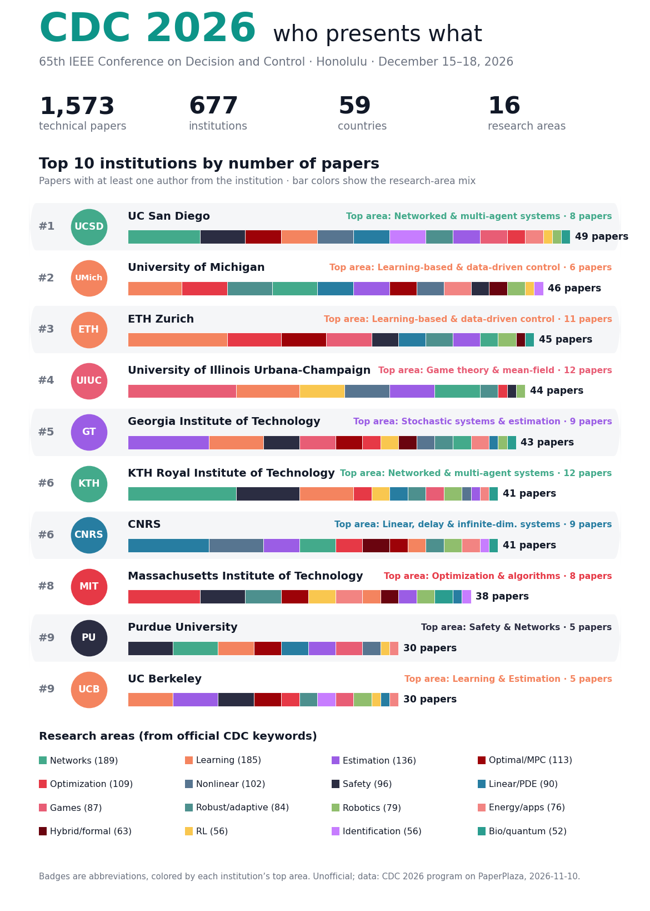

# CDC 2026 Explorer

Three searches over the IEEE CDC 2026 program (65th IEEE Conference on Decision and Control, Honolulu, December 15–18, 2026):

- **Find your institution.** Rank, paper count, research-area mix, most frequent co-author institutions, and every paper with its session, time and room.
- **Search by topic or paper.** Type a topic or paste an abstract. The page finds the closest CDC papers by meaning and shows which institutions and countries wrote the most of them, plus the companies among them.
- **Search by author.** Any author or session chair: their papers in program order (session, day, time, room), sessions they chair, and co-authors. Institution pages also list their authors.

Built in the same format as the [NeurIPS 2026 Explorer](https://juevn.github.io/neurips2026/) by Jueun Kim.



## What's here

- `index.html`: the whole site. Static, no build step, works on GitHub Pages.
- `data.js`: institution totals and metadata.
- `papers.js` + `papers.bin`: the topic-search index. Paper titles, institutions, area, keywords, session (code, day, time, room) and author names and affiliations as printed in the public program, and one 384-dimensional embedding per paper (int8, about 0.6 MB).
- `cdc2026_institutions.csv`: the institution table as a CSV.
- `scripts/`: how the data was built (see below). `raw/` holds the downloaded program pages and is git-ignored.

## Numbers (program dated 2026-11-10)

| | |
|---|---|
| Entries in the program | 1,674 (285 sessions) |
| Papers in technical sessions (Regular, Invited, RI) | 1,573 |
| Institutions | 677, from 59 countries |
| Papers with a company author | 5% |
| Top 5 | UC San Diego 49 · Univ. of Michigan 46 · ETH Zurich 45 · UIUC 44 · Georgia Tech 43 |

## How it was made

- **Source.** The public daily program pages on PaperPlaza (`CDC26_ContentListWeb_1..5.html`): session code, type, room, time, chairs; each paper's title, authors with affiliation, keywords and abstract.
- **What counts.** Rankings use papers in Regular, Invited and RI (rapid-interaction) sessions. Plenaries, HT talks, tutorial talks and Monday workshops are in topic search (tagged) but not ranked.
- **Names.** About 1,170 affiliation spellings are mapped with a hand-checked table of ~560 institutions (`scripts/institutions.py`). Joint affiliations ("Université Paris-Saclay, CNRS, CentraleSupélec") count for each institution. Unmatched names are kept as written.
- **Research areas.** From the official CDC keywords chosen by authors: 167 keywords grouped into 16 areas. Each paper goes to the area its keywords point to most (first keyword weighted 1.5×). 86 entries without keywords are placed by their 15 nearest papers.
- **Topic search.** Runs in the browser with `Xenova/bge-small-en-v1.5` (transformers.js, ~33 MB, downloaded once), the same model used offline (`BAAI/bge-small-en-v1.5`) on title + abstract. Falls back to keyword matching on titles if the model can't load.
- **Authors.** Grouped by PaperPlaza author ID, as in the official author index (3,575 people). IDs with the same name and a shared institution are merged (7 duplicate accounts).
- **Sector.** Companies and corporate labs are industry. Universities, government and national labs, and public institutes (CNRS, Inria, CNR) are academia.

Caveats: "Northeastern University" is almost all the Boston university, but a few authors may be from Northeastern University (Shenyang). Countries are only set for institutions in the hand-checked table.

## Rebuild

```bash
python3 -m venv venv && venv/bin/pip install torch --index-url https://download.pytorch.org/whl/cpu
venv/bin/pip install sentence-transformers numpy matplotlib beautifulsoup4 lxml
# download the 5 daily pages into raw/ from https://css.paperplaza.net/conferences/conferences/CDC26/program/
python3 -I scripts/parse_cdc.py raw cdc.json
venv/bin/python -I scripts/build.py cdc.json .
venv/bin/python -I scripts/poster.py .
python3 -I scripts/assemble.py . cdc.json
```

To link "Open an issue" to your repo, set `REPO_URL` in `scripts/template/_body.html` and re-run `assemble.py`.

Unofficial project, not affiliated with or endorsed by IEEE, the IEEE Control Systems Society or CDC.
