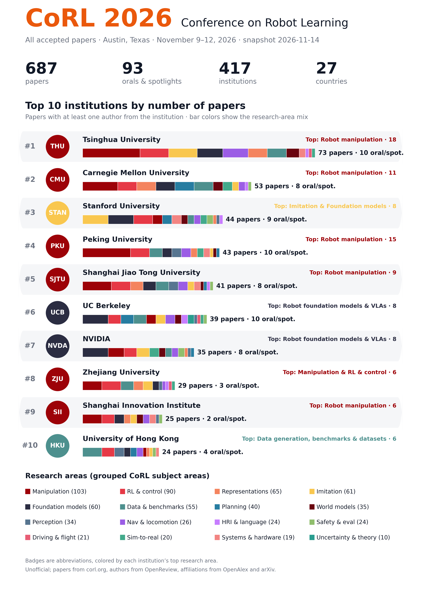

# CoRL 2026 Explorer

All 687 accepted papers of the Conference on Robot Learning 2026 (Austin, Texas, November 9–12), in the same format as the [CDC 2026 Explorer](../../cdc2026/) and the [NeurIPS 2026 DSC Explorer](../neurips2026_dsc/):

- **Find your institution.** Rank, paper count, orals and spotlights, research-area mix, authors, co-author institutions.
- **Search by topic or paper.** Type a topic or paste an abstract; the closest CoRL papers by meaning, and who wrote them.
- **Search by author.** Every author, with their papers, poster boards, talk slots and co-authors.
- **DSC papers.** The dynamic systems & control papers, picked with the rubric of the [NeurIPS 2026 DSC Explorer](../neurips2026_dsc/): tier, subcategory, a one-line reason, and the institutions behind them.



## Numbers (snapshot 2026-11-14)

| | |
|---|---|
| Accepted papers | 687 (21 orals, 72 spotlights; every paper also has a poster board) |
| Authors | 4,066 (OpenReview profiles) |
| Institutions | 417, from 27 countries |
| Papers with ≥1 institution | 599 (87%) |
| Author slots with an affiliation | 4,607 of 5,202 (89%) |
| Papers with a company author | 35% |
| Top 6 | Tsinghua 73 · CMU 53 · Stanford 44 · Peking 43 · SJTU 41 · UC Berkeley 39 |

## Sources

1. **Paper list and sessions:** the official [accepted-papers page](https://www.corl.org/program/accepted-papers): title, OpenReview ID, oral/spotlight session, poster session and board number, rooms. The tally matches everywhere: 687 on the page; each session's declared size equals the parsed count (P1 228, P2 231, P3 228; 7 orals × 3; 8 spotlights × 9); every oral and spotlight also has a poster slot.
2. **Authors, abstracts, keywords:** OpenReview, via the public snapshots in [operatic-ai/corl-explorer](https://github.com/operatic-ai/corl-explorer) and [gisbi-kim/conference-explorers](https://github.com/gisbi-kim/conference-explorers) (all 687). [jaywu109/corl-2026-papers](https://github.com/jaywu109/corl-2026-papers) has the same 687 IDs and identical author lists. The OpenReview API itself is blocked from this machine.
3. **Affiliations, per author:**
   - [OpenAlex](https://openalex.org/), looked up by arXiv DOI (593 of 601 arXiv papers found, accepted after a title + author-name check);
   - the arXiv paper itself for the 1,412 authors OpenAlex left blank: HTML front matter and PDF page 1 were read against a written rubric ([`scripts/affil_rubric.md`](scripts/affil_rubric.md)); an author gets an institution only when superscripts, a per-author affiliation line, a group block or a single-institution byline tie them to it (1,357 filled; ambiguous or absent cases left blank). Cross-check: 96% of these authors share an institution with gisbi-kim's independent byline scrape;
   - for papers with no per-author data, gisbi-kim's paper-level institution list.
4. **Links:** arXiv (601), code (312) and project pages (521), the union of the three community lists.

## Dynamic systems & control (DSC) tab

- **Rubric:** [`scripts/dsc_rubric.md`](scripts/dsc_rubric.md), the NeurIPS 2026 DSC Explorer rubric applied unchanged (only the header differs). Core = controls, identifies, estimates or certifies a dynamical system (6 subcategories); adjacent = a control researcher would read it but control is not the contribution (5 subcategories, including end-to-end robot policy learning as "sequential decision making close to control"); out = everything else (perception, VLA architecture, datasets, ...).
- **Labels:** an LLM read all 687 titles and abstracts against the rubric (6 batches, `work/dsc/labels/`). An independent second pass relabelled 217 papers blind (every core paper + 60 adjacent + 60 out): tier agreement 81.6% (kappa 0.72), in/out 92.2%, subcategory 79%. The 40 disagreements were adjudicated by hand (`work/dsc/validate/adjudicated.json`, overrides in `work/dsc/overrides.json`); 11 of the 14 changes moved RL-trained humanoid whole-body controllers from core to adjacent.
- **Result:** 288 DSC papers (86 core, 202 adjacent; 42% of CoRL). Core: robotics & embodied control 49, identification 13, safety 12, estimation 7, optimal control 4, learning-based control 1. Adjacent: sequential decision making 173, model-based RL 26, other 3. Top by DSC papers: Tsinghua 28, CMU 26 (10 core), Stanford 21, UC Berkeley 17.
- Agreement is lower than at NeurIPS (91.5%) because the controller vs policy-learning border runs through most robotics papers; treat counts as indicative. `corl2026_dsc_institutions.csv` has the DSC institution table; the paper CSV has `dsc_tier`, `dsc_subcategory`, `dsc_reason`.

## How the site data is made

- **Research areas** are CoRL's 22 official subject areas (each paper's primary area, its first keyword), grouped into 16. Free-text keywords are shown under each paper.
- **Names** are normalized with the CDC table (`scripts/institutions.py`), the NeurIPS rules (`scripts/institutions_extra.txt`) and CoRL rules for labs and robotics companies (`scripts/institutions_corl.txt`). OpenAlex country suffixes ("Honda (Japan)") are dropped. Unmatched names are kept as written; ones that look like companies (Robotics, AI, Dynamics, …, without University/Institute/Lab) count as industry.
- **Counting:** a paper counts once for every institution with at least one author on it. The fractional count splits each paper equally across authors, then across each author's institutions.
- **Topic search** runs in the browser with `Xenova/bge-small-en-v1.5`, the same model used offline (`BAAI/bge-small-en-v1.5`) on title + abstract.
- **Author IDs** are OpenReview profile IDs; the 44 that were e-mail addresses are replaced by a hash and never published.

Caveats: about 88 papers (mostly not on arXiv) have no affiliation at all, so small institutions are undercounted. OpenAlex affiliations can lag (an author's previous institution). Area borders are fuzzy; treat an institution's mix as indicative.

## Files

- `index.html`, `data.js`, `papers.js`, `papers.bin`, `assets/`: the static site.
- `corl2026_institutions.csv`: the institution table. `corl2026_explorer_papers.csv`: every paper with area, sessions, authors with their institutions, and links.
- `corl2026_papers.json` / `.csv`: the merged dataset (all sources, per-author affiliations with their source).
- `work/tally_report.txt`: the tally and coverage report. `work/affil_labels/`: the arXiv author-block labels.
- `raw/` (git-ignored, ~3.6 GB with the arXiv PDFs): every downloaded source.

## Rebuild

```bash
python3 scripts/tally_merge.py                      # parse corl.org, merge sources -> corl2026_papers.json
python3 scripts/fetch_openalex.py                   # OpenAlex by arXiv ID (cached in raw/openalex)
python3 scripts/fetch_arxiv_docs.py                 # arXiv HTML for authors still missing (cached)
python3 scripts/fetch_arxiv_pdfs.py                 # arXiv PDFs for the same papers (cached)
python3 scripts/build_affil_batches.py 46           # evidence batches -> work/affil_batches
# label work/affil_batches/batch_NN.json into work/affil_labels/batch_NN.json with scripts/affil_rubric.md,
# validate with scripts/check_labels.py
python3 scripts/tally_merge.py                      # merge again with the labels
<venv>/bin/python -I scripts/embed.py corl2026_papers.json work/emb.npy   # needs sentence-transformers
# DSC: label work/dsc/batches/*.json into work/dsc/labels/ with scripts/dsc_rubric.md (check with scripts/check_dsc.py);
# second pass on work/dsc/validate/, compare with scripts/compare_dsc.py, adjudications in work/dsc/overrides.json
python3 -I scripts/build.py corl2026_papers.json raw work/emb.npy .
<venv>/bin/python -I scripts/poster.py .            # needs matplotlib
python3 -I scripts/assemble.py . corl2026_papers.json
```

Unofficial, not affiliated with CoRL.
