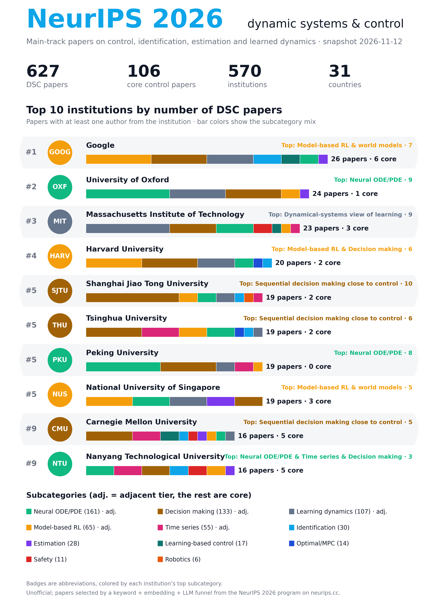

# NeurIPS 2026 Dynamic Systems & Control Explorer

The NeurIPS 2026 main-track papers on dynamic systems and control: control, system identification, estimation, learned dynamics and safety certificates. Three searches, in the same format as the [CDC 2026 Explorer](../../cdc2026/):

- **Find your institution.** Rank, paper count (all and core), subcategory mix, authors, co-author institutions.
- **Search by topic or paper.** Type a topic or paste an abstract; the closest DSC papers by meaning, and who wrote them.
- **Search by author.** Every author of a DSC paper, with their papers and co-authors.



## Numbers (snapshot 2026-11-12)

| | |
|---|---|
| Accepted main-track papers | 7,888 |
| DSC papers (core + adjacent) | 627 |
| Core | 106 |
| Adjacent | 521 |
| Institutions | 570, from 31 countries |

## What counts as DSC

The rubric is in [`scripts/classify/rubric.md`](scripts/classify/rubric.md). Each paper gets a tier, a subcategory and a one-line reason (shown on the site).

- **Core**: the main contribution controls, identifies, estimates or certifies a dynamical system. Subcategories: optimal control & MPC, system identification & learned dynamics for control (Koopman methods included), stability & safety certificates, estimation & filtering, learning-based & adaptive control theory, robotics & embodied control.
- **Adjacent**: a control researcher would read it, but control is not the contribution. Subcategories: model-based RL & world models, neural ODE/PDE surrogates, dynamical-systems view of learning, time series & dynamical-system reconstruction, sequential decision making close to control.
- **Out**: everything else, including the false friends listed in the rubric ("state space model" sequence models, controllable generation, RLHF, VLA policies, …).

Only the main track is included. The Evaluations & Datasets, Position Paper and Journal tracks are left out.

## How papers were selected

1. **Data.** Public neurips.cc feeds: `neurips-2026-orals-posters.json` (authors, institutions, sessions) and `neurips-2026-abstracts.json`. Orals appear twice in the feed and are merged by OpenReview forum. Author keywords and the official primary area are not public for 2026, so the unofficial research-area clusters of the [NeurIPS 2026 Explorer](https://github.com/juevn/neurips2026) stand in for the area audit.
2. **Recall stage.** A weighted keyword lexicon with false-friend patterns, plus `bge-small-en-v1.5` embedding similarity to 30 hand-picked seed papers and to the rubric's subcategory descriptions. Embedding scores are taken relative to the corpus centroid and thresholded by percentile, because raw cosine similarities are compressed. 2,144 candidates.
3. **Precision stage.** An LLM read the title and abstract of every candidate against the rubric and assigned tier, subcategory and reason.
4. **Recall check.** A random sample of 300 non-candidates was classified the same way: 2 were in (1 core, 1 adjacent), an estimated recall loss of under 1%. For the remaining 5,444 non-candidates, 720 were read in full (0 core, 9 adjacent). The other 4,724 went through a liberal LLM title screen. The 302 flagged titles were read in full, which added 4 core papers.
5. **Validation.** An independent second LLM pass relabelled a stratified sample of 284 papers (all core, plus samples of adjacent, rejected candidates and rejected non-candidates). Agreement on tier was 91.5% (Cohen's κ 0.87). In/out agreement was 98.2%, and subcategory agreement was 84%. The 24 disagreements were adjudicated by hand ([`work/validate/adjudicated.json`](work/validate/adjudicated.json)). The rubric was clarified once: Koopman and system-identification papers are core even when their downstream use is prediction. Eight further hand decisions are in [`work/overrides.json`](work/overrides.json).
6. **Area audit.** Tiers were cross-tabulated against the research-area clusters. All 37 in-scope papers filed under unrelated areas were re-read (one changed). A sample of 60 rejected papers from RL, robotics, time series, theory and AI-for-science areas was also re-read, and none belonged. Inclusion rates: diffusion & generative modelling 33%, RL 18%, robotics 17%, theory & optimization 10%, AI for science 10%, vision and language areas under 3%.
7. **Author prior.** The authors' publication history in control venues was looked up on OpenAlex and Semantic Scholar for 72 rejected papers with strong keyword scores. DBLP and the OpenReview API were blocked. The prior was used only to flag papers for re-reading, never to include or exclude. One paper was flagged and stayed out. Matching is by name and institution, not profile ID.

Caveats: the labels come from an LLM with human adjudication of disagreements, not from expert review of every paper. The core/adjacent border and the subcategory borders are fuzzy, so treat an institution's mix as indicative. Hand-label your own sample before citing the counts.

## Files

- `index.html`, `data.js`, `papers.js`, `papers.bin`, `assets/`: the static site.
- `neurips2026_dsc_papers.csv`: every DSC paper with tier, subcategory, reason, session, authors and institutions.
- `neurips2026_dsc_institutions.csv`: the institution table.
- `work/final_labels.json`: tier, subcategory, reason and label source for all 7,888 main-track papers.
- `scripts/`: the pipeline (below). `scripts/institutions.py` is the CDC table, extended by `scripts/institutions_extra.txt`.

## Rebuild

```bash
python3 -m venv venv && venv/bin/pip install torch --index-url https://download.pytorch.org/whl/cpu
venv/bin/pip install sentence-transformers numpy matplotlib
python3 -I scripts/fetch.py raw
python3 -I scripts/normalize.py raw neurips.json
venv/bin/python -I scripts/classify/recall.py neurips.json work work/seeds.txt
python3 -I scripts/classify/make_batches.py neurips.json work 80 300
# LLM pass: label work/batches/batch_XX.json into work/labels/batch_XX.json with scripts/classify/rubric.md
python3 -I scripts/classify/aggregate.py neurips.json work
python3 -I scripts/classify/finalize_labels.py neurips.json work
python3 -I scripts/classify/audit_areas.py neurips.json work
venv/bin/python -I scripts/build.py neurips.json work .
venv/bin/python -I scripts/poster.py .
python3 -I scripts/assemble.py . neurips.json
```

Validation helpers: `validate_sample.py`, `compare_passes.py`. Remainder handling: `make_rest_batches.py`, `title_screen.py`. Author prior: `author_prior.py` (OpenAlex), `author_prior_s2.py` (Semantic Scholar).

Unofficial project, not affiliated with or endorsed by the NeurIPS Foundation. Format adapted from the [NeurIPS 2026 Explorer](https://github.com/juevn/neurips2026) by Jueun Kim.
