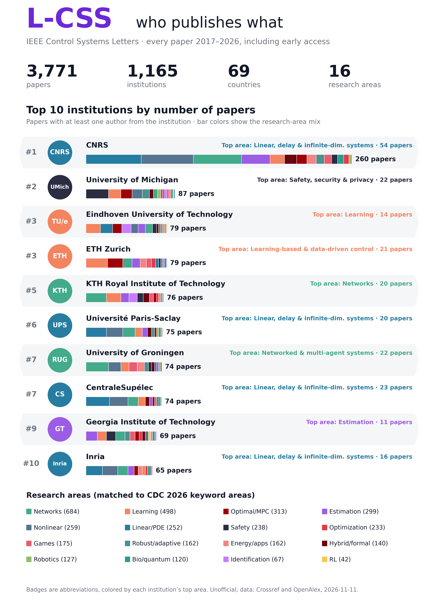

# L-CSS Explorer

Searches over every paper in IEEE Control Systems Letters (L-CSS), from the first issue in 2017 to today, including early access:

- **Find your institution.** Rank, paper count, papers per year, research-area mix, most frequent co-author institutions, the authors from there, and every paper.
- **Search by topic or paper.** Type a topic or paste an abstract. The page finds the closest L-CSS papers by meaning and shows which institutions and countries wrote the most of them. Filter by year or to papers with arXiv/code.
- **Most cited papers.** Every paper ranked by citations, filtered by year range, institution or research area. The home page shows the all-time top 10.
- **Search by author.** Any L-CSS author: their papers (newest first), institutions, co-authors, ORCID and OpenAlex links.

Sister site of the [CDC 2026 Explorer](../../../cdc2026/), same format and the same 16 research areas.



## What's here

- `index.html`: the whole site. Static, no build step, works on GitHub Pages.
- `data.js`: institution totals (per area and per year) and metadata.
- `papers.js` + `papers.bin`: paper titles, DOIs, dates, volume/pages, authors, institutions, area, arXiv/code links, and one 384-dimensional embedding per paper (int8).
- `lcss_institutions.csv`, `lcss_papers.csv`: the institution table and the full paper list as CSV.
- `scripts/`: how the data is built (see below). `raw/`, `lcss.json` and `venv/` are git-ignored.

## Numbers (snapshot 2026-11-11)

| | |
|---|---|
| Papers | 3,771 (34 in early access), 2017–2026 |
| Institutions | 1,165, from 69 countries |
| Authors | 6,444 |
| Papers with a company author | 3.7% |
| Most cited | Input-to-State Safety With Control Barrier Functions (2019), 347 citations |
| Top 5 | CNRS 260 · Univ. of Michigan 87 · TU Eindhoven 79 · ETH Zurich 79 · KTH 76 |

## How it was made

- **Papers.** Crossref lists every DOI for ISSN 2475-1456, with titles, authors and affiliations as deposited by IEEE. Front matter (tables of contents, editorial board, editorials) is dropped. OpenAlex adds abstracts (all but ~50 papers), institution matches with country and type, open-access status and known arXiv copies.
- **Early access.** IEEE early-access articles have a DOI but no volume and a placeholder page "1-1". Only those that went online in the last 12 months are labeled early access. A few older records were never updated in Crossref and show only the year.
- **Names.** The hand-checked CDC table of ~560 institutions (`scripts/institutions.py`) is applied to the printed affiliation first. Otherwise the OpenAlex institution is used (mapped through the table when the country agrees), and otherwise the organisation named in the printed affiliation. "Northeastern University" with a Chinese address is Northeastern University (Shenyang).
- **Research areas.** L-CSS has no author keywords, so each paper takes the similarity-weighted vote of its 15 nearest CDC 2026 papers (the CDC areas come from the official keywords). This needs `../../../cdc2026/` next to this folder.
- **Authors.** Grouped by ORCID and OpenAlex author ID, but an ID only counts when the name fits (IEEE sometimes deposits one ORCID on two co-authors). Same name plus a shared institution also merges.
- **Citations.** The larger of Crossref's and OpenAlex's citation count, refreshed on every update. Both only count citations from indexed papers, so they are lower than Google Scholar.
- **arXiv and code.** arXiv copies known to OpenAlex, plus an arXiv title search (near-identical title and a shared author surname). Code links come from GitHub/GitLab URLs in arXiv abstracts and comments, and from GitHub repositories whose README names the title or arXiv ID.

## Update

```bash
./update.sh            # new papers + arXiv/GitHub search for new papers + rebuild
./update.sh --quick    # new papers + rebuild, no link search (a few minutes)
./update.sh --links    # only continue the arXiv/GitHub search and rebuild
```

The first time, `update.sh` creates `venv/` and installs torch (CPU), sentence-transformers, numpy and matplotlib. The searches are cached in `scripts/links/`, so later runs only look at new papers. To look again for arXiv copies of papers not found before, run `python3 -I scripts/links/arxiv_match.py lcss.json scripts/links/arxiv_cache.json --retry-misses`.

Optional: OpenAlex now gives requests without an API key a small shared daily budget. If a fetch fails with a budget error, get a free key at https://openalex.org/settings/api and run `OPENALEX_API_KEY=... ./update.sh`.

Unofficial project, not affiliated with or endorsed by IEEE or the IEEE Control Systems Society.
