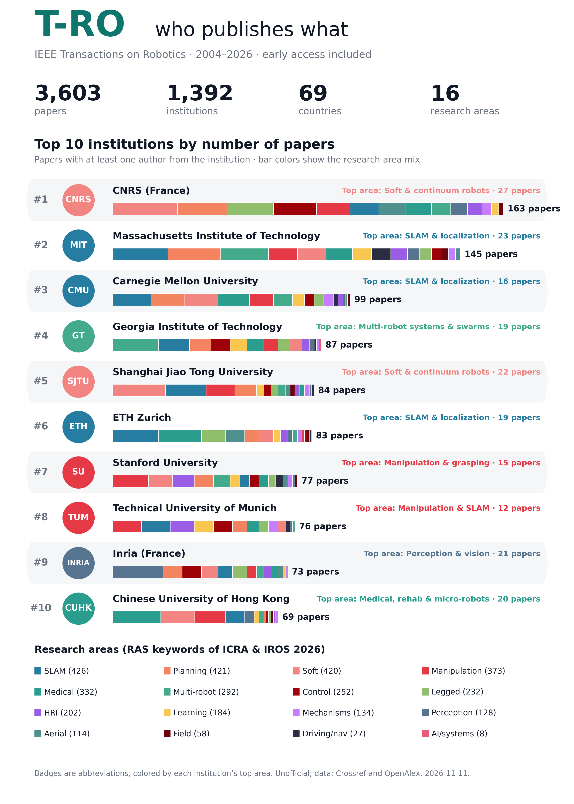

# T-RO Explorer

Three searches over every paper in IEEE Transactions on Robotics (T-RO), from volume 20 (2004, when T-RA split into T-RO and T-ASE) to today, early access included:

- **Find your institution.** Rank, paper count, research-area mix, papers per year, most frequent co-author institutions, its authors, and every paper. The table can be ranked for a single year or a single area.
- **Search by topic or paper.** Type a topic or paste an abstract. The page finds the closest T-RO papers by meaning and shows which institutions and countries wrote the most of them, plus the companies among them.
- **Search by author.** Any T-RO author: their papers (newest first), research areas and co-authors.

Built in the same format as the [RA-L Explorer](../ral/) and the [CDC 2026 Explorer](../../../cdc2026/).



## What's here

- `index.html`: the whole site. Static, no build step, works on GitHub Pages.
- `data.js`: institution totals (all years, per year, per area) and metadata.
- `papers.js` + `papers.bin`: the topic-search index. Titles, DOIs, dates, volume/issue/pages, authors, institutions, OpenAlex keywords, arXiv/code links, and one 384-dimensional embedding per paper (int8).
- `tro_institutions.csv`: the institution table as a CSV, with per-area and per-year counts.
- `scripts/`: how the data is built (below). `scripts/links/` keeps the arXiv/GitHub results so they don't have to be searched again. `raw/` holds downloads and caches and is git-ignored.

## How it was made

- **Papers.** [Crossref](https://www.crossref.org/) DOIs for ISSN 1552-3098 / 1941-0468, plus 1546-1904 and the old T-RA ISSN 1042-296X (volume 20 issues 1–3 are filed there), keeping volume ≥ 20. Front matter, editorials and errata are dropped. A paper with no volume yet is early access (since volume 40, 2024, T-RO has no issue numbers: final papers have a volume and continuous pages). Year = volume year (volume 20 = 2004); early-access papers use their online date. OpenAlex records that sit under another source are looked up by DOI.
- **Abstracts, institutions, authors.** From [OpenAlex](https://openalex.org/): each author's affiliation linked to a registered institution (ROR) with country and type. Company branches roll up to one company ("Google (United States)" → Google). Authors OpenAlex couldn't link are matched by institution name inside the printed affiliation; the rest count for no institution. Authors are grouped by OpenAlex author ID, and IDs with the same name and a shared institution (or ORCID) are merged.
- **Research areas.** The IEEE RAS keywords (the list authors pick from for RA-L, ICRA and IROS). All 305 keywords in the [ICRA 2026 program](https://ras.papercept.net/conferences/conferences/ICRA26/program/) are grouped by hand into 16 broad areas, following the [IROS 2026](https://2026.ieee-iros.org/program/) session themes (IROS 2026 publishes no per-paper keywords). The ~2,700 ICRA 2026 papers with abstracts get the area their own keywords point to most (first keyword weighted 1.5×). Each T-RO paper gets the area with the most similarity-weighted votes among its 15 closest ICRA 2026 papers in meaning. The grouping is in `AREAS` in `scripts/build.py`.
- **Topic search.** Runs in the browser with `Xenova/bge-small-en-v1.5` (~33 MB, downloaded once), the same model used offline (`BAAI/bge-small-en-v1.5`) on title + abstract. Falls back to keyword matching on titles.
- **arXiv and code links.** arXiv IDs from OpenAlex, plus title matching against every arXiv paper in cs.RO (since 2004) or mentioning T-RO (≥ 0.92 title similarity and a shared author surname). Code: GitHub/GitLab URLs in the paper or arXiv abstract/comments, and GitHub repos whose README names the paper's title or arXiv ID (only if the repo looks like the paper's own code).
- **Most cited papers.** The home page lists the 10 T-RO papers with the most citations in OpenAlex, and the Most cited page (`#/cited`) ranks every paper, filterable by year range, institution and research area. Counts come from `scripts/cited.py`, refreshed by `update.sh`. Google Scholar counts are higher.
- **Sector.** OpenAlex type "company" is industry; everything else (universities, government labs, hospitals, nonprofits, facilities) is academia.

Caveats: T-RO papers have no per-paper RAS keywords to use, so areas are an estimate from the closest ICRA papers. OpenAlex sometimes misses or mislinks affiliations (about 3% of author slots have no institution).

## Update

```bash
scripts/update.sh            # new papers and early access; a few minutes
scripts/update.sh --arxiv    # also refresh arXiv links
scripts/update.sh --github   # also search GitHub for papers not searched yet (slow, resumable; set GITHUB_TOKEN to speed up)
```

`update.sh` runs, in order: `fetch.py` (Crossref + OpenAlex → `tro.json`), `inst_meta.py` (institution acronyms, cached), `cited.py` (citation counts), `parse_icra.py` (once; `raw/icra26.json` was copied from the RA-L folder), `github_match.py` / `links.py` (optional), `build.py` (data files; embeddings are cached so only new papers are embedded), `poster.py`, `assemble.py`.

First-time setup: `python3 -m venv venv && venv/bin/pip install torch --index-url https://download.pytorch.org/whl/cpu && venv/bin/pip install sentence-transformers numpy matplotlib beautifulsoup4 lxml` (or point `PY=` at an existing Python with these).

OpenAlex now needs a free API key for cursor paging, so `fetch.py` pages one publication year at a time, which works without a key. Set `OPENALEX_API_KEY` if you hit the keyless daily limit.

Unofficial project, not affiliated with or endorsed by IEEE or the IEEE Robotics and Automation Society.

The example on the Topics page is my RA-L paper (title and abstract in `scripts/example_paper.json`), so it shows which T-RO papers are closest to it.
