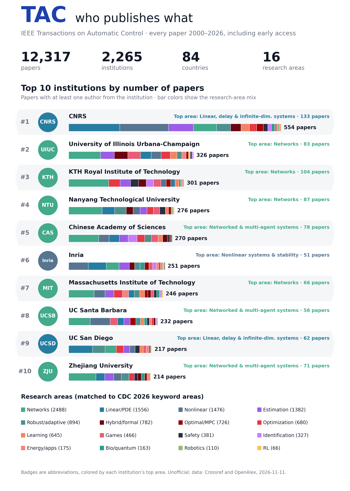

# TAC Explorer

Three searches over every paper in IEEE Transactions on Automatic Control (TAC) from 2000 to today, including early access:

- **Find your institution.** Rank, paper count, papers per year, research-area mix, most frequent co-author institutions, the authors from there, and every paper.
- **Search by topic or paper.** Type a topic or paste an abstract. The page finds the closest TAC papers by meaning and shows which institutions and countries wrote the most of them. Filter by year or to papers with arXiv/code.
- **Search by author.** Any TAC author: their papers (newest first), institutions, co-authors, ORCID and OpenAlex links.

Sister site of the [CDC 2026 Explorer](../cdc2026/) and the [L-CSS Explorer](../lcss/), same format and the same 16 research areas.



## What's here

- `index.html`: the whole site. Static, no build step, works on GitHub Pages.
- `data.js`: institution totals (per area and per year) and metadata.
- `papers.js` + `papers.bin`: paper titles, DOIs, dates, volume/pages, authors, institutions, area, arXiv/code links, and one 384-dimensional embedding per paper (int8).
- `tac_institutions.csv`, `tac_papers.csv`: the institution table and the full paper list as CSV.
- `scripts/`: how the data is built (see below). `raw/`, `tac.json` and `venv/` are git-ignored (`venv` links to `../lcss/venv`).

## Numbers (snapshot 2026-11-11)

| | |
|---|---|
| Papers | 12,317 (243 in early access), 2000–2026 |
| Institutions | 2,265, from 84 countries |
| Authors | 13,112 |
| Papers with a company author | 4.6% |
| On arXiv / with code (OpenAlex-linked only so far) | 3,082 / 15 |
| Top 5 | CNRS 554 · UIUC 326 · KTH 301 · NTU Singapore 276 · Chinese Academy of Sciences 270 |

## How it was made

- **Papers.** Crossref lists every DOI for ISSN 0018-9286 published from 2000 on, with titles, authors and affiliations as deposited by IEEE. Front matter (tables of contents, editorial board, editorials, indexes, calls for papers) and errata are dropped; full papers, technical notes and comments stay. OpenAlex (fetched one publication year at a time) adds abstracts, institution matches with country and type, open-access status and known arXiv copies.
- **Early access.** IEEE early-access articles have a DOI but no volume and a placeholder page "1-1". Only those that went online in the last 12 months are labeled early access. A few older records were never updated in Crossref and show only the year.
- **Affiliations.** IEEE deposited printed affiliations with Crossref only from 2022 on. For older papers they come from OpenAlex (its matched institutions and raw affiliation strings), which misses about 1–5% of authors (up to 9% in 2000).
- **Names.** The hand-checked CDC table of ~560 institutions (`scripts/institutions.py`) is applied to the printed affiliation first. Otherwise the OpenAlex institution is used (mapped through the table when the country agrees), and otherwise the organisation named in the printed affiliation. "Northeastern University" with a Chinese address is Northeastern University (Shenyang).
- **Research areas.** TAC has no author keywords, so each paper takes the similarity-weighted vote of its 15 nearest CDC 2026 papers (the CDC areas come from the official keywords). This needs `../cdc2026/` next to this folder.
- **Most cited.** The home page lists the 10 most-cited TAC papers since 2000, by OpenAlex citation counts (`scripts/citations.py`, refreshed on every `update.sh` run). The papers CSV has a `citations_openalex` column.
- **Authors.** Grouped by ORCID and OpenAlex author ID, but an ID only counts when the name fits (IEEE sometimes deposits one ORCID on two co-authors). Same name plus a shared institution also merges.
- **arXiv and code.** So far only arXiv copies known to OpenAlex, with code links from GitHub/GitLab URLs in their arXiv abstracts and comments. The arXiv title search and GitHub README search (as for L-CSS) have not been run for TAC yet: about 14,000 papers at the API rate limits take roughly a day each. Run `./update.sh --links` to start them; they resume where they stopped.
- **Duplicates and non-papers.** Book reviews, authors' replies, "Scanning the issue", errata and indexes are dropped. A paper registered twice (same title and first author) is kept once.

## Update

```bash
./update.sh            # new papers + arXiv/GitHub search for new papers + rebuild
./update.sh --quick    # new papers + rebuild, no link search (a few minutes)
./update.sh --links    # only continue the arXiv/GitHub search and rebuild
```

Embeddings are cached in `raw/embeddings.npz`, so rebuilds only embed new papers. The first time, `update.sh` creates `venv/` and installs torch (CPU), sentence-transformers, numpy and matplotlib. The searches are cached in `scripts/links/`, so later runs only look at new papers. To look again for arXiv copies of papers not found before, run `python3 -I scripts/links/arxiv_match.py tac.json scripts/links/arxiv_cache.json --retry-misses`.

Optional: OpenAlex now gives requests without an API key a small shared daily budget. If a fetch fails with a budget error, get a free key at https://openalex.org/settings/api and run `OPENALEX_API_KEY=... ./update.sh`.

Unofficial project, not affiliated with or endorsed by IEEE or the IEEE Control Systems Society.
